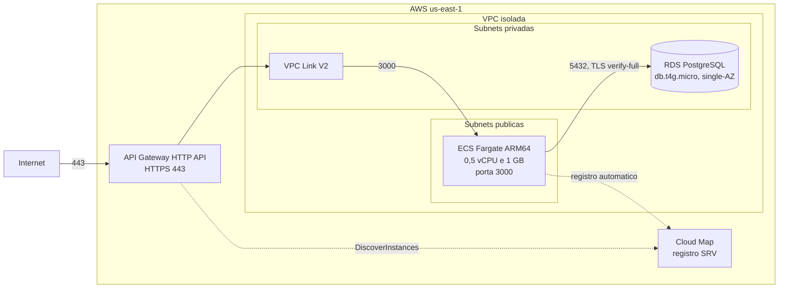
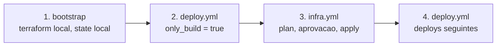

<p align="center">
  
</p>

# Simple-api

Repositório do Desafio Técnico KXC (Arquiteto de Cloud AWS). Uma API em Node.js que consulta um PostgreSQL, empacotada em container e provisionada na AWS por Terraform, com pipeline de CI/CD no GitHub Actions.

**Estado em 13/10/2026:** o código da aplicação, o Terraform e os workflows estão escritos e passam nas verificações locais e nos jobs de CI do PR #1 que não precisam de credencial (app, sast, dockerfile, iac, secrets e workflows ficaram verdes; o job `plan` foi pulado porque o state em S3 ainda não existe). **Nada foi aplicado na AWS.** Não existe `plan` com backend real, recurso criado nem número de desempenho medido na AWS. A seção [Pendências](#pendências) lista o que não foi verificado.

Rótulos usados nos documentos: `[FATO: fonte]` foi lido no repositório ou numa fonte citada, `[HIPÓTESE]` é inferência não confirmada, `[PROPOSTA]` é recomendação.

## Visão geral

A API tem três rotas ([`application/README.md`](application/README.md)):

| Rota | Comportamento |
|---|---|
| `GET /` | 200 com `API OK!`, sem tocar no banco |
| `GET /connect` | 200 com a versão do PostgreSQL. Responde 503 com mensagem genérica se o banco falhar |
| `GET /health` | 200 enquanto o processo está de pé (liveness). Não consulta o banco |

A API não tem autenticação (contrato do desafio). Na AWS a única proteção na borda é o throttling do API Gateway. [FATO: [`docker-compose.yml`](docker-compose.yml) linhas 4-5]

## Arquitetura



Sem ALB e sem NAT Gateway. As tasks ficam em subnet pública com IP público e só aceitam tráfego do security group do VPC Link. Security groups, tabela de regras, portas e o fluxo da internet até o banco estão em [`docs/arquitetura.md`](docs/arquitetura.md).

## Decisões

Cada decisão tem um ADR em [`docs/adr/`](docs/adr/README.md). Todas vêm de [`01-arquitetura-e-restricoes.md`](.kiro/steering/01-arquitetura-e-restricoes.md) e estão travadas.

| Decisão | Resumo | ADR |
|---|---|---|
| Entrada | API Gateway HTTP API no lugar do ALB, por FinOps | [0001](docs/adr/0001-api-gateway-http-api-no-lugar-de-alb.md) |
| Integração | VPC Link V2 e Cloud Map com registro SRV | [0002](docs/adr/0002-vpc-link-v2-e-cloud-map-srv.md) |
| Compute | ECS Fargate ARM64, 0,5 vCPU e 1 GB, com base no benchmark LOCAL | [0003](docs/adr/0003-ecs-fargate-arm64-0-5-vcpu-1-gb.md) |
| Banco | RDS PostgreSQL `db.t4g.micro`, single-AZ, privado | [0004](docs/adr/0004-rds-postgresql-db-t4g-micro-single-az-privado.md) |
| Rede | Sem NAT, tasks em subnet pública com SG restrito | [0005](docs/adr/0005-sem-nat-tasks-em-subnet-publica.md) |
| Segredos e TLS | `verify-full` e senha gerenciada pelo RDS, com rotação de 7 dias | [0006](docs/adr/0006-tls-verify-full-e-segredo-gerenciado-pelo-rds.md) |
| EKS | Só como laboratório efêmero (não implementado) | [0007](docs/adr/0007-eks-somente-como-laboratorio-efemero.md) |
| Terraform | Roots separados: bootstrap, principal e eks-lab | [0008](docs/adr/0008-terraform-com-roots-separados.md) |
| Pipeline | OIDC e um environment por workflow | [0009](docs/adr/0009-pipeline-com-oidc-e-um-environment-por-workflow.md) |
| Security groups | Regras por chaves simbólicas, não `templatefile()` | [0010](docs/adr/0010-regras-de-sg-por-chaves-simbolicas.md) |
| DR | Backups automáticos e PITR (documentado, não implementado) | [0011](docs/adr/0011-dr-via-pitr.md) |
| Divergência | Por que o desenho difere da "arquitetura alvo" (ALB e NAT) do autor | [0012](docs/adr/0012-divergencia-da-arquitetura-alvo.md) |

## Estrutura do repositório

```
simple-api/
├── application/       # API Node.js + Express + pg, Dockerfile e testes
├── infrastructure/    # Terraform: bootstrap/, raiz da stack, modules/, environments/, config/
├── .github/workflows/ # ci.yml, deploy.yml, infra.yml
├── docs/              # ADRs, arquitetura, autoscaling, DR e benchmark local
├── tests/load/        # script k6, driver e resultados do benchmark LOCAL
├── tools/             # residual-check.sh (varredura de resíduos após destroy) e console-utf8.ps1 (UTF-8 no console do Windows)
├── .kiro/steering/    # decisões e regras do projeto (fonte das decisões travadas)
├── AGENTS.md          # contrato de trabalho para agentes de IA
└── docker-compose.yml # ambiente local: Postgres 16 e a API
```

Detalhes da aplicação em [`application/README.md`](application/README.md) e da infraestrutura em [`infrastructure/README.md`](infrastructure/README.md).

## Como executar localmente

Pré-requisito: Docker com Compose. O ambiente local sobe um Postgres 16 com autenticação SCRAM e a API, sem TLS (`DB_SSLMODE=disable`) e sem Secrets Manager. Não é usado na AWS. [FATO: [`docker-compose.yml`](docker-compose.yml) e [`application/.env.example`](application/.env.example)]

1. Copiar o exemplo de variáveis e trocar o placeholder da senha. O arquivo `application/.env` é ignorado pelo git.

   ```powershell
   Copy-Item application/.env.example application/.env
   # edite application/.env e troque <DB_PASSWORD> por uma senha local
   ```

   ```bash
   cp application/.env.example application/.env
   ```

2. Subir os containers. O `--env-file` é necessário: o serviço `db` exige `DB_USER`, `DB_PASSWORD` e `DB_DATABASE` e falha sem eles.

   ```bash
   docker compose --env-file application/.env up --build
   ```

3. Testar. As portas ficam publicadas só em `127.0.0.1`.

   ```bash
   curl http://127.0.0.1:3000/
   curl http://127.0.0.1:3000/connect
   curl http://127.0.0.1:3000/health
   ```

Variáveis do `application/.env.example`:

| Variável | Valor de exemplo | Observação |
|---|---|---|
| `API_PORT` | `3000` | Porta da API |
| `DB_HOST` | `db` | Nome do serviço no Compose (o Compose também fixa este valor) |
| `DB_PORT` | `5432` | |
| `DB_DATABASE` | `simple_api` | |
| `DB_USER` | `simple_api` | |
| `DB_PASSWORD` | `<DB_PASSWORD>` | Placeholder: trocar. Obrigatória quando `DB_SECRET_ARN` não está definido |
| `DB_POOL_MAX` | `3` | Mesmo valor usado na AWS. Padrão do código: 5 |
| `DB_SSLMODE` | `disable` | Só local. O padrão do código é `verify-full` e exige `DB_SSL_CA_FILE` |
| `LOG_LEVEL` | `info` | `debug`, `info`, `warn` ou `error` |

A lista completa de variáveis, inclusive `DB_SSL_CA_FILE`, `DB_SECRET_ARN` e `SHUTDOWN_TIMEOUT_MS`, está em [`application/README.md`](application/README.md). O container da API roda com 0,5 CPU, 1 GB de memória e sistema de arquivos somente leitura, para se parecer com a task do Fargate. [FATO: [`docker-compose.yml`](docker-compose.yml) linhas 37-39]

## Como validar

Todas as verificações abaixo rodam sem credencial AWS. O CI executa o mesmo conjunto em cada pull request ([`ci.yml`](.github/workflows/ci.yml)).

### Aplicação (container Node 24)

O projeto exige Node 24 (`engines.node` = `>=24 <25`), e a máquina de desenvolvimento tem Node 22. Por isso os testes rodam num container, com uma cópia do código para não escrever no repositório:

```bash
docker run --rm -v "$PWD/application:/src:ro" node:24.21.0-alpine3.24 sh -c \
  "cp -r /src /app && cd /app && npm ci && npm test && npm run lint && npm audit --omit=dev --audit-level=high"
```

Os testes de integração (`npm run test:int`) precisam de um Postgres real com SCRAM e das variáveis `INTEGRATION_DB_*` ([`application/README.md`](application/README.md)). [FATO: a última execução registrada do conjunto foi em 13/10/2026, com 44 testes passando, 4 ignorados (integração, que rodou à parte) e `npm audit` sem achados. Este comando não foi reexecutado ao escrever este README porque o daemon do Docker estava desligado]

### Terraform

```bash
terraform fmt -check -recursive infrastructure
terraform -chdir=infrastructure init -backend=false -input=false -lockfile=readonly
terraform -chdir=infrastructure validate
terraform -chdir=infrastructure/bootstrap init -backend=false -input=false -lockfile=readonly
terraform -chdir=infrastructure/bootstrap validate
```

Os módulos não têm lockfile próprio. Para rodar os testes (`.tftest.hcl`) de um módulo, copie o lockfile da raiz, inicialize e teste. O exemplo usa o módulo `security-group`; apague o lockfile copiado depois, para não sujar o `git status`:

```bash
cp infrastructure/.terraform.lock.hcl infrastructure/modules/security/security-group/
terraform -chdir=infrastructure/modules/security/security-group init -backend=false -input=false -lockfile=readonly
terraform -chdir=infrastructure/modules/security/security-group test
rm infrastructure/modules/security/security-group/.terraform.lock.hcl
```

Os módulos com testes são `budget`, `ecr`, `ecs`, `oidc`, `security-group`, `route` e `subnet`. O CI roda `terraform test` em cada um. [FATO: [`ci.yml`](.github/workflows/ci.yml) linhas 155-180]

Resultado deste turno (13/10/2026, Terraform local):

- `terraform fmt -check -recursive infrastructure`: código de saída 0.
- `terraform validate` nos dois roots (`infrastructure` e `infrastructure/bootstrap`): `Success! The configuration is valid.`
- `terraform test` do módulo `security-group`: `Success! 10 passed, 0 failed.`

O `terraform plan` não faz parte desta validação: os data sources `aws_availability_zones` e `aws_ecr_repository` exigem a AWS.

### Scanners

| Ferramenta | Alvo | Comando local |
|---|---|---|
| Gitleaks | histórico e arquivos | `gitleaks git . --no-banner --redact` e `gitleaks dir . --no-banner --redact` |
| Semgrep | `application/` | ver o passo `sast` em [`ci.yml`](.github/workflows/ci.yml) (roda pela imagem oficial fixada por digest) |
| Hadolint | Dockerfile | `hadolint application/Dockerfile` |
| Trivy image | imagem construída | `trivy image --severity HIGH,CRITICAL --ignore-unfixed --exit-code 1 <imagem>` |
| Trivy config | Terraform | `trivy config infrastructure --ignorefile infrastructure/.trivyignore --severity HIGH,CRITICAL --exit-code 1` |
| TFLint | Terraform | `tflint --recursive --chdir infrastructure --config infrastructure/.tflint.hcl` |
| actionlint | workflows | `actionlint` |

Exceções do Trivy ficam em [`infrastructure/.trivyignore`](infrastructure/.trivyignore), cada uma com justificativa e data. A exceção do Gitleaks está em [`.gitleaks.toml`](.gitleaks.toml).

### Console do Windows (UTF-8)

No Windows PowerShell 5.1 o console usa a página de código OEM, então a tabela do Trivy (bordas Unicode) aparece como `Ôö£ÔöÇ` e CLIs Python como o aws cli podem falhar com `'charmap' codec can't encode character`. Antes de rodar essas ferramentas, faça `. .\tools\console-utf8.ps1`: ele ajusta só a sessão atual (UTF-8 no console e `PYTHONUTF8=1`), sem tocar no perfil do usuário. [FATO: [`tools/console-utf8.ps1`](tools/console-utf8.ps1)]

## Como o pipeline funciona

Três workflows em [`.github/workflows/`](.github/workflows):

| Workflow | Gatilho | Environment | Role AWS (OIDC) |
|---|---|---|---|
| [`ci.yml`](.github/workflows/ci.yml) | `pull_request` | nenhum | `gha-plan` (leitura), só no job `plan` e só para PR do mesmo repositório |
| [`deploy.yml`](.github/workflows/deploy.yml) | push na `main` com mudança em `application/**`, ou `workflow_dispatch` com `only_build` | `deploy` | `gha-deploy` |
| [`infra.yml`](.github/workflows/infra.yml) | `workflow_dispatch` com `plan`, `apply` ou `destroy` e a tag da imagem | `infra`, com aprovação manual | `gha-infra` |

- **Autenticação:** somente OIDC, sem access keys. Cada role aceita um `sub` exato: `repo:<GITHUB_OWNER>/simple-api:pull_request`, `...:environment:deploy` e `...:environment:infra`. Um environment por workflow garante que um workflow não assume a role de outro ([ADR 0009](docs/adr/0009-pipeline-com-oidc-e-um-environment-por-workflow.md)).
- **Imagem:** construída uma vez, com a tag igual ao SHA do commit, para `linux/amd64` e `linux/arm64`. As tags do ECR são imutáveis, então o push é pulado se a tag já existe. O scan (Trivy) e o deploy usam o digest gravado no ECR, sem rebuild. [FATO: [`deploy.yml`](.github/workflows/deploy.yml) linhas 54-137]
- **Deploy:** renderiza a task definition ativa com a imagem nova, atualiza o service, espera estabilidade, roda o smoke test (`GET /` e `GET /connect` = 200) e, se algo falhar, volta o service para a revisão anterior. [FATO: [`deploy.yml`](.github/workflows/deploy.yml) linhas 146-214]
- **Infra:** `plan` salvo, aprovação do environment `infra` e `apply` do plano salvo. Nada de `terraform apply` em `ci.yml` ou `deploy.yml`.
- **Actions** de terceiros fixadas por SHA de commit, com a tag em comentário.

### Ordem do primeiro deploy



1. **Bootstrap** ([`infrastructure/bootstrap`](infrastructure/bootstrap/main.tf)): aplicado uma vez, localmente, com aprovação e um perfil de escrita. Cria o bucket de state, o ECR, o budget e o OIDC com as roles. O state local é sensível: nunca versionar nem abrir. Exemplo de variáveis em [`terraform.tfvars.example`](infrastructure/bootstrap/terraform.tfvars.example), com `<GITHUB_OWNER>` e `<EMAIL>` como placeholders.
2. **GitHub:** criar os environments `deploy` e `infra` (só a branch `main`; aprovação obrigatória no `infra`) e as variáveis do repositório: `AWS_PLAN_ROLE_ARN`, `AWS_DEPLOY_ROLE_ARN`, `AWS_INFRA_ROLE_ARN`, `TF_STATE_BUCKET`, `TF_STATE_KEY` e `AWS_REGION`. `API_URL` (saída `api_endpoint` da stack) só é necessária depois do passo 3, para o smoke test.
3. **Primeira imagem:** `deploy.yml` com `only_build = true` publica a imagem no ECR sem tocar no ECS. Sem ela a task não sobe.
4. **Stack:** `infra.yml` com `action = apply` e a tag dessa imagem.
5. **Deploys seguintes:** a cada push em `application/**` na `main`. Se o service ainda não existe, o deploy falha com uma mensagem pedindo o `infra.yml`. [FATO: [`deploy.yml`](.github/workflows/deploy.yml) linhas 152-156]

O service ignora mudanças em `task_definition` e `desired_count`. O Terraform cria a primeira revisão, o pipeline publica as seguintes e o autoscaling controla a contagem. Consequência: mudar variável de ambiente, CPU ou memória pelo Terraform não chega ao service sem um deploy pelo pipeline. Detalhes em [`infrastructure/README.md`](infrastructure/README.md) linhas 45-50.

## Estimativa de custo

Só entram números da tabela de preços de [`02-finops-guardrails.md`](.kiro/steering/02-finops-guardrails.md) (região us-east-1). O que não tem fonte lá aparece como **a verificar**. Cálculos mensais usam 730 horas por mês, uma convenção de cálculo.

| Item | Preço de referência | Mensal em 24x7 | Fonte |
|---|---|---|---|
| Fargate ARM64, 1 task de 0,5 vCPU e 1 GB | US$ 0,03238/vCPU-h e US$ 0,00356/GB-h, ou US$ 0,01975/h | US$ 14,42 (cálculo) | aws.amazon.com/fargate/pricing |
| IPv4 público, 1 por task | US$ 0,005/h | US$ 3,65 por IP (cálculo) | aws.amazon.com/vpc/pricing |
| API Gateway HTTP API | US$ 1,00 por milhão de requisições (primeiros 300 milhões) | Depende do volume | aws.amazon.com/api-gateway/pricing |
| Cloud Map | US$ 0,10 por recurso registrado/mês e US$ 1,00 por milhão de chamadas de descoberta | Medido em 13/10: 72.921 chamadas para 1.078.187 requisições do API Gateway, ~1 por 15 requisições (ver [`docs/plano/05-custo-real.md`](docs/plano/05-custo-real.md)) | aws.amazon.com/cloud-map/pricing |
| Zona privada do Route 53 | US$ 0,50/mês | US$ 0,50 | tabela da steering |
| RDS `db.t4g.micro` on-demand | ~US$ 0,016/h, **aproximado** | ~US$ 11,68 (cálculo sobre valor aproximado) | Pricing Calculator, a confirmar |
| AWS Budgets sem ações | Gratuito | US$ 0 | aws.amazon.com/aws-cost-management/aws-budgets/pricing |
| NAT Gateway (não usado) | US$ 0,045/h e US$ 0,045/GB (exemplo de Ohio) | US$ 32,85 (cálculo) | aws.amazon.com/vpc/pricing |
| EKS control plane (só no lab, não implementado) | US$ 0,10/h em suporte padrão | Lab: ~US$ 0,17/h no total, por até 6 h | aws.amazon.com/eks/pricing |

- **Estimativa da steering para a stack ECS em 24x7:** cerca de US$ 34/mês (RDS ~14, task ~14,42, IPv4 3,65 e o resto ~2). O planejado é cerca de US$ 41 de crédito, com meta de no máximo US$ 45, dentro de US$ 100 de crédito. [FATO: [`02-finops-guardrails.md`](.kiro/steering/02-finops-guardrails.md) seção "Orçamento e estimativas"] Esses totais são estimativa, não medição, e a decomposição do planejado de US$ 41 não está registrada.
- **A verificar:** VPC Link V2, CloudWatch Logs (retenção de 14 dias, `[PROPOSTA]`), Secrets Manager (segredo gerenciado pelo RDS), ECR (armazenamento), S3 do state, storage gp3 de 20 GiB do RDS (`[PROPOSTA]`), tráfego de saída, preço exato do RDS e o ALB que a stack não usa.
- Cada task adicional do autoscaling custa o Fargate mais um IPv4 (US$ 0,02475/h, cálculo). Ver [`docs/autoscaling.md`](docs/autoscaling.md).
- Se o API Gateway chamar `DiscoverInstances` a cada requisição, o custo por requisição vai de US$ 1 para US$ 2 por milhão. Conferir no Cost Explorer depois do primeiro teste de carga. [HIPÓTESE da steering, não confirmada]

## FinOps

- **Budget mensal de US$ 45 sem créditos.** O módulo de budget fixa `include_credit = false` (o padrão do provider é `true`, e com créditos incluídos o custo líquido fica zerado e nenhum alerta dispara). Os alertas são de gasto **real**, em US$ 5 (anomalia cedo), 50%, 80% e 100%. Não há alerta de previsão, porque a AWS precisa de cerca de 5 semanas de histórico. O budget nasce no bootstrap, antes da stack. [FATO: [`modules/budget/main.tf`](infrastructure/modules/budget/main.tf) linhas 1-23]
- **Budget não é disjuntor.** O billing atualiza pelo menos uma vez por dia. Quem corta gasto é o `destroy` e o TTL.
- **TTL e tags.** Todo recurso leva `Project`, `Env`, `Track`, `Owner`, `ManagedBy` e `TTL` por `default_tags`. O `TTL` vem de `var.ttl` (padrão `none`). Os recursos do bootstrap levam `Track=bootstrap` e são ignorados pela varredura de resíduos. [FATO: [`infrastructure/providers.tf`](infrastructure/providers.tf) e [`infrastructure/bootstrap/providers.tf`](infrastructure/bootstrap/providers.tf)]
- **A stack roda só durante a janela de avaliação** e depois é destruída: `infra.yml` com `action = destroy` (com aprovação). O bootstrap (bucket, ECR, budget, OIDC) permanece.
- **Depois do destroy, rodar [`tools/residual-check.sh`](tools/residual-check.sh).** A varredura é somente leitura. Código 0 é limpo, 1 indica recursos que podem continuar cobrando e 2 é erro de consulta, que **não** significa limpo. Destroy sem varredura é tarefa incompleta. As revisões da task definition continuam registradas depois do destroy (`skip_destroy = true`) e o script não as lista. [FATO: [`infrastructure/README.md`](infrastructure/README.md) linha 50]
- **Antes de qualquer recurso na AWS:** custo por hora e por mês com fonte, o que continua cobrando depois do destroy, por quanto tempo fica ligado e se o serviço é aceito no plano da conta. Sem isso e sem aprovação explícita, nada é criado. [FATO: [`02-finops-guardrails.md`](.kiro/steering/02-finops-guardrails.md) e regra 7 de [`AGENTS.md`](AGENTS.md)]

## Documentação

| Documento | Conteúdo |
|---|---|
| [`docs/arquitetura.md`](docs/arquitetura.md) | Diagramas, security groups, portas, subnets e fluxo internet até o banco |
| [`docs/autoscaling.md`](docs/autoscaling.md) | Métrica, alvo, min e max, cooldowns, roteamento, conexões com o banco |
| [`docs/dr.md`](docs/dr.md) | RPO e RTO, restore PITR, recriação em outra região ou conta |
| [`docs/performance/benchmark-local.md`](docs/performance/benchmark-local.md) | Resumo dos CSV do benchmark LOCAL, conferido com a steering |
| [`docs/performance/benchmark-aws.md`](docs/performance/benchmark-aws.md) | Carga na AWS (API Gateway e dentro da VPC), rotulada AWS, com ressalvas |
| [`docs/plano/`](docs/plano/00-plano-execucao.md) | Plano de execução, auditoria de IAM da `gha-infra`, FinOps do apply e desenho da carga na VPC |
| [`docs/verificacoes/`](docs/verificacoes/2026-10-13-estado-final.md) | Verificação das afirmações dos docs contra dados e estado real (13/10/2026) |
| [`docs/adr/`](docs/adr/README.md) | Decisões de arquitetura |
| [`docs/KIRO-SETUP.md`](docs/KIRO-SETUP.md) | Pacote de guardrails de agentes de IA |
| [`AGENTS.md`](AGENTS.md) | Contrato de trabalho e regras anti-alucinação |

## Pendências

Estado em 13/10/2026 (fim da janela): a stack foi criada na AWS, testada e **destruída** (o bootstrap permanece). Resultados em [`docs/performance/benchmark-aws.md`](docs/performance/benchmark-aws.md) e no plano de execução em [`docs/plano/`](docs/plano/00-plano-execucao.md)). Abaixo, o que foi verificado e o que continua sem verificação.

**Verificado na AWS**
- Bootstrap aplicado (state local, nunca versionado): bucket de state, ECR, budget, provedor OIDC, roles `gha-plan`, `gha-deploy` e `gha-infra` e o Resource Group `kxc-simple-api-RG` (por tag `Project`). GitHub configurado: environments `deploy` e `infra` (com aprovação) e variáveis do repositório.
- Apply da stack pelo `infra.yml` em duas rodadas (plan de 50 recursos). A primeira falhou parcialmente por permissões da `gha-infra` (`ecr:DescribeImages`, `apigateway:TagResource`, `route53:CreateHostedZone` e leituras do Route 53, `rds:ListTagsForResource`); cada falta foi corrigida em `modules/oidc/main.tf` com o motivo em comentário (least privilege iterativo) e o bootstrap reaplicado. A segunda rodada concluiu (17 recursos criados, sem novo AccessDenied).
- O Free plan desta conta recusa `backup_retention_period = 7` (`FreeTierRestrictionError`): o `dev` usa 1, ou seja, **PITR de 1 dia** (o alvo documentado é 7).
- Pelo API Gateway, `GET /`, `/health` e `/connect` respondem 200. O RDS é PostgreSQL 16.13 e o `max_connections` do `db.t4g.micro` é 79 (medido). O TLS `verify-full` e a leitura do segredo gerenciado pelo RDS funcionam (o `/connect` conecta). A imagem arm64 roda no Fargate.
- `deploy.yml` de ponta a ponta: build multi-arch, Trivy nos dois digests, SBOM, deploy por digest no ECS e smoke do pipeline (run 38461659742).
- Carga na AWS, rotulada AWS e separada da LOCAL: pelo API Gateway (smoke e baseline a 40 req/s) e dentro da VPC (load até 500, stress até 1.000 e rampa até 1.500 req/s, sem erro; o breakpoint não foi atingido). Detalhes, ressalvas e dados em `tests/load/results/`.

**Ainda não verificado**
- (Resolvido em 14/10) Custo real da janela e Cloud Map: uso bruto de US$ 1,454 em 13/10, coberto por crédito (saldo US$ 138,52). O Cloud Map cobra por chamada de API, mas foram ~1 chamada por 15 requisições do API Gateway (+6,8% sobre o custo do API Gateway), não uma por requisição; o mecanismo (cache) não foi verificado. Ver [`docs/plano/05-custo-real.md`](docs/plano/05-custo-real.md).
- Autoscaling: medido em um spike (100 → 1.500 req/s pelo API Gateway): decisão de scale-out ~5 min depois do salto, task nova rodando ~44 s depois da decisão, 3 tasks em ~8,7 min e volta a 1 task ~22 min depois do fim do spike. Uma execução só; durante a saturação o p95 chegou a 290 ms e o erro a 0,17% num minuto ([`docs/autoscaling.md`](docs/autoscaling.md), [`docs/performance/benchmark-aws.md`](docs/performance/benchmark-aws.md)).
- Soak de 2 h e 3 séries por perfil (cada série usou a mesma task); throttling de CPU do Fargate não medido. O spike foi feito com o throttling do estágio elevado temporariamente (restaurado em 50/100).
- Rotação de 7 dias do segredo: a app invalida o cache em `28P01` (testado com cliente falso), mas uma rotação real não foi exercitada.
- Conectividade das tasks até ECR, CloudWatch Logs e Secrets Manager por IP público, sem NAT nem endpoints: funcionou nos testes, sem análise de falhas.
- **Destroy executado** pelo `infra.yml` (run 38486943440: 0 to add, 0 to change, 50 to destroy; gate `infra` aprovado). Conferência com `tools/residual-check.sh`: na noite do destroy o script saiu com **exit 1**, porque a seção por tag listava itens já removidos (índice de tags com atraso: as 7 regras de SG e o service sumiram do índice em ~12 h) e artefatos de ECS que a AWS nunca remove (cluster `INACTIVE` e task definitions). Em 14/10 o script passou a **classificar o ECS pelo status real** (cluster ou service ativo, ou não classificável, é resíduo; `INACTIVE` é ignorado; task definition `ACTIVE` só é informada), com teste em `tools/test-residual-check.sh` (12 casos, validado por teste de mutação), e a varredura saiu com **exit 0** (só o aviso esperado do GuardDuty). As task definitions `simple-api-dev:1` e `:2` ficam `ACTIVE` por `skip_destroy = true` (sem custo).

**Build, testes e CI**
- Build `linux/arm64` verificado no CI (PR #1) e no `deploy.yml`. O build arm64 local não é possível (o builder do Docker Desktop não tem QEMU). Não foi verificado se `TRIVY_PLATFORM` chega ao scan arm64 do `deploy.yml`.
- Os testes da app citados vêm da última execução registrada (48 testes: 44 passam, 4 de integração ignorados, 0 falham).
- O `ci.yml` só roda em `pull_request`, e a integração neste projeto é por merge local no fork (sem PR), então a `main` atual não passou pelo CI. As três últimas execuções registradas (PRs antigos) falharam. O teste `terraform test` do módulo `oidc` estava desatualizado e foi corrigido e validado localmente (6 passam; budget, ecr e ecs seguem verdes). A falha do `terraform plan` do CI não foi diagnosticada.

**Desempenho**
- O benchmark local não foi repetido com a imagem final (`--cpus=0.5`, `DB_POOL_MAX=3`) e a compatibilidade do `load.js` local com k6 2.x não foi conferida. Números LOCAIS e AWS não se misturam.

**Segurança**
- A API é pública e sem autenticação (contrato do desafio).
- A aplicação usa o usuário master do banco. Um usuário só com `CONNECT` é pendência documentada.
- A role `gha-infra` cria roles e policies com prefixo `simple-api-*` com conteúdo livre (escalada dentro do prefixo). O IAM Access Analyzer não foi usado para validar as policies.
- O `infra.yml` tem um job só: a aprovação acontece antes do plan ser visto. Separar `plan` e `apply` é melhoria pendente.
- O `trivy-action` roda no job do `deploy.yml` que tem credenciais AWS temporárias, e o job `plan` do `ci.yml` executa HCL do próprio PR com a role de leitura.
- A saída das tasks em 443 e 53 para `0.0.0.0/0` é necessária sem NAT, mas é ampla.
- O SHA-256 do CA bundle da RDS foi medido uma vez localmente (a AWS não publica checksum).
- O repositório é público e o account id aparece nos logs das Actions (via OIDC): considerar torná-lo privado ao final.
- O hook local do gitleaks (`.pre-commit-config.yaml`) não existe; o gitleaks roda só no CI.

**DR**
- Um restore PITR real foi testado (13/10/2026): pedido até instância `available` em 15,4 min e marcador verificado em 16,4 min; RPO observado de ~3 a 8 min (uma execução, banco quase vazio). O RTO total de um incidente (decisão, troca de endpoint, `terraform apply`) não foi medido; cópia entre regiões e snapshot entre contas não foram testados.
- Com a configuração atual de `dev`, o `destroy` apaga os dados e os backups automáticos ([`docs/dr.md`](docs/dr.md)).
- Replicação entre regiões e snapshot entre contas: só documentados, por escopo e por custo.

**Não implementado**
- Laboratório EKS: `infrastructure/eks-lab/`, `k8s/`, `eks-lab.yml`, a branch `gitops` e a role `gha-eks-lab` não existem ([ADR 0007](docs/adr/0007-eks-somente-como-laboratorio-efemero.md)).
- Notificação dos alarmes: o código cria três alarmes (crédito de CPU do RDS, espaço livre e respostas 5xx da API), mas `alarm_action_arns` é vazio por padrão, então nenhum alarme avisa ninguém.
- Rotina de atualização do digest da imagem e das dependências (Dependabot ou Renovate): não decidida.

**Valores `[PROPOSTA] a calibrar` no `dev.tfvars`:** throttling do estágio (50 req/s e burst 100; limita os testes pelo API Gateway), storage do RDS (20 GiB), retenção de logs (14 dias), TTL do registro SRV (10 s) e os limiares dos três alarmes.

**Divergências entre a steering e o código** (vale o código; nada foi alterado para bater com a documentação):
- A steering fala numa flag `ingress_mode = "alb"` que não existe no código.
- A estimativa da steering para 3 tasks via API Gateway assume throttling de 1.000 req/s no estágio; o `dev.tfvars` define 50.
- A estimativa de 500 req/s por task de 0,5 vCPU era conservadora: dentro da VPC a task sustentou 1.000 req/s sem erro.
