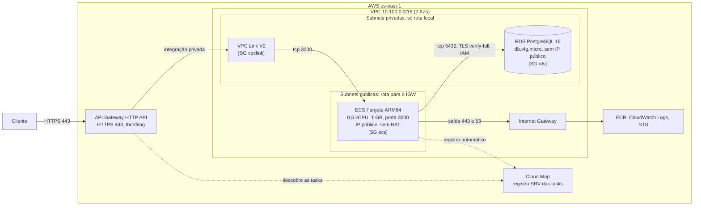
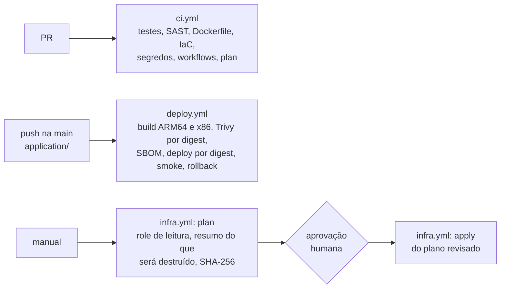
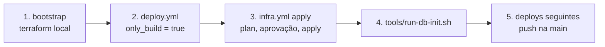

<p align="center">
  
</p>

# Simple-api na AWS

Entrega do **Desafio Técnico de Arquiteto de Cloud (AWS) da KXC Tecnologia**: uma API Node.js que consulta um PostgreSQL, publicada na AWS com Dockerfile, Terraform e CI/CD no GitHub Actions, numa VPC própria.

**Estado em 15/10/2026:**
- A stack foi aplicada, testada e destruída na AWS em cinco janelas, entre 13 e 15/10.
- Os testes cobriram carga, spike com autoscaling, soak de 2 h, restore PITR e um laboratório EKS.
- Hoje a stack está **destruída**. Só o bootstrap continua aplicado: bucket de state, ECR, budget e as roles da pipeline.
- Cada número deste README vem de uma medição com arquivo de dados no repositório.

Sumário:
1. [O desafio e o que foi entregue](#1-o-desafio-e-o-que-foi-entregue)
2. [Inconsistências do repositório recebido](#2-inconsistências-do-repositório-recebido)
3. [Arquitetura](#3-arquitetura): [diagrama](#31-diagrama), [fluxo e security groups](#32-fluxo-da-internet-até-o-banco-e-security-groups), [decisões e trade-offs](#33-decisões-e-trade-offs)
4. [Plano de autoscaling](#4-plano-de-autoscaling)
5. [Plano de disaster recovery](#5-plano-de-disaster-recovery)
6. [CI/CD](#6-cicd)
7. [Segurança e least privilege](#7-segurança-e-least-privilege)
8. [FinOps e custo real](#8-finops-e-custo-real)
9. [Resultados medidos na AWS](#9-resultados-medidos-na-aws)
10. [Diferencial: laboratório EKS](#10-diferencial-laboratório-eks)
11. [Como executar](#11-como-executar)
12. [Estrutura do repositório e documentação](#12-estrutura-do-repositório-e-documentação)
13. [O que ficou pendente](#13-o-que-ficou-pendente)

---

## 1. O desafio e o que foi entregue

### Requisitos obrigatórios

| Requisito | Como foi atendido | Evidência |
|---|---|---|
| **Containerização** com Dockerfile otimizado | Multi-stage. Base Node 24 Alpine **fixada por digest**. Usuário `node` (uid 1000). Só dependências de produção. Bundle de CAs do RDS baixado com `ADD --checksum`. Imagem para `linux/arm64` e `linux/amd64`. | [`application/Dockerfile`](application/Dockerfile); hadolint e Trivy no CI |
| **IaC** com Terraform para toda a base | VPC, subnets, rotas, security groups, RDS, ECS, API Gateway, Cloud Map, autoscaling, IAM e ECR em módulos. Três roots: bootstrap, stack principal e lab EKS. Nada foi criado pelo console. | [`infrastructure/`](infrastructure/README.md) |
| **CI/CD** com build e deploy automático | Quatro workflows: `ci.yml` em todo PR; `deploy.yml` em push na `main`, com build, scan, deploy por digest, smoke e rollback; `infra.yml` com plan, aprovação e apply; `eks-lab.yml` para o lab. | [Seção 6](#6-cicd) |
| **Ambiente isolado** numa VPC nova | VPC `10.100.0.0/16` no `dev`, em 2 AZs, com subnets públicas e privadas. `hml` e `prod` usam `10.110` e `10.120` pelo mesmo código. | [`environments/`](infrastructure/environments) |

### Diferenciais

| Diferencial | Como foi atendido |
|---|---|
| **FinOps, o desafio de ouro**: API Gateway no lugar do ALB | API Gateway HTTP API com integração privada por VPC Link V2 e descoberta das tasks no Cloud Map. **Não há ALB nem NAT Gateway.** Custo real das janelas de teste na [seção 8](#8-finops-e-custo-real). |
| Serviços gerenciados (ECS, EKS) | ECS Fargate ARM64 na trilha principal. Um laboratório EKS efêmero atrás do mesmo API Gateway, com Argo CD ([seção 10](#10-diferencial-laboratório-eks)). |
| PostgreSQL no RDS | RDS PostgreSQL 16 `db.t4g.micro` em subnets privadas, com TLS `verify-full` e autenticação IAM. |
| Módulos Terraform | Módulos de rede, security group, IAM, RDS, ECS, API Gateway, Cloud Map, autoscaling, OIDC, ECR e budget, com `terraform test`. |
| Least privilege (IAM) | Cinco roles da pipeline por OIDC, cada uma presa a um contexto. A role da app só pode `rds-db:connect` como um usuário que só tem `CONNECT` ([seção 7](#7-segurança-e-least-privilege)). |

### A API

| Rota | Comportamento |
|---|---|
| `GET /` | 200 com `API OK!`, sem tocar no banco |
| `GET /connect` | 200 com a versão do PostgreSQL. Se o banco falhar, 503 com mensagem genérica |
| `GET /health` | 200 enquanto o processo está de pé (liveness, sem consultar o banco) |

A API não tem autenticação, por contrato do desafio. A proteção na borda é o throttling do API Gateway.

## 2. Inconsistências do repositório recebido

O desafio avisa que o repositório tem inconsistências propositais e pede que ele seja tratado como um legado. Estas foram encontradas e tratadas:

| # | Encontrado no legado | Tratamento |
|---|---|---|
| F-INF-2 | SG do ECS liberava a porta **8084**, mas a app escuta **3000** | Regra na 3000, aceita só a partir do SG do VPC Link |
| F-INF-3 | SG do ECS sem saída para **5432**: a app não alcançaria o banco | Saída para 5432 só para o SG do RDS |
| F-INF-4 | Placeholders `${ALB_SG_ID}`, `${NAT_GW_ID}` e `${IGW_ID}` nos JSON de regras e rotas | Regras por chave simbólica, resolvidas pelo Terraform ([ADR 0010](docs/adr/0010-regras-de-sg-por-chaves-simbolicas.md)) |
| F-INF-9 | VPC sem `enable_dns_hostnames` (a zona privada do Cloud Map exige) | DNS ligado na VPC |
| F-INF-10 | Service ECS sem circuit breaker nem `service_registries` | Circuit breaker com rollback e registro automático no Cloud Map |
| F-INF-7 | `azs` fixas em `us-east-1a/b/c` no módulo de rotas | AZs lidas de `aws_availability_zones` |
| F-INF-8 | `map_public_ip_on_launch` declarado e não usado | Usado: subnets públicas com IP público, privadas sem |
| F-INF-11 | Sem módulos de ECR, RDS, API Gateway, Cloud Map, autoscaling e OIDC; sem provider nem backend | Módulos criados; backend S3 com lock nativo |
| F-INF-5 | Policy do AWS Load Balancer Controller (EKS) no projeto de ECS | Usada só onde faz sentido: no controller do lab EKS |
| F-INF-6 | Módulo `parameter-store` levaria o segredo ao tfstate | Não usado: a senha master é gerenciada pelo RDS |
| F-INF-1, F-INF-12 | SG de ALB em 8080 e 443, listener em 80/HTTP, rota privada para um NAT inexistente | Não instanciados: o desenho não tem ALB nem NAT |
| F-APP-3 | Um `new Client()` por requisição, sem timeout e sem `finally` | Pool com limite, timeouts de conexão e de consulta |
| F-APP-4 | Conexão com o banco sem TLS | TLS `verify-full` com o bundle de CAs do RDS |
| F-APP-6 | `npm audit`: 8 vulnerabilidades, 1 crítica (`proxy-addr`) | Dependências atualizadas; `npm audit` no CI |
| F-APP-7 | Sem `Dockerfile` nem `.dockerignore` | Criados (seção 1) |

Também entraram na aplicação:
- `GET /health`;
- logs JSON com `request_id`;
- encerramento ordenado no SIGTERM, mais drenagem no SIGUSR2 para o EKS;
- autenticação IAM no RDS.

A lista completa, com a origem de cada item, está em [`docs/arquitetura.md`](docs/arquitetura.md#divergências-entre-a-steering-e-o-código).

## 3. Arquitetura

### 3.1 Diagrama



- **Sem ALB e sem NAT.** O API Gateway chega às tasks pelo VPC Link V2, cujas interfaces ficam nas subnets privadas, e encontra as tasks pelo Cloud Map.
- **As tasks ficam em subnet pública** com IP público, para baixar a imagem e mandar logs sem NAT. A entrada delas aceita só o SG do VPC Link.
- **O RDS fica nas subnets privadas**, sem IP público e sem rota para a internet.
- Detalhe completo, com sub-redes e rotas, em [`docs/arquitetura.md`](docs/arquitetura.md).

### 3.2 Fluxo da internet até o banco e security groups

| # | Salto | Porta | Controle |
|---|---|---|---|
| 1 | Cliente → API Gateway | 443 | TLS gerenciado e throttling do estágio `$default` |
| 2 | API Gateway → Cloud Map | n/a | A integração descobre IP e porta das tasks (registro SRV) |
| 3 | API Gateway → VPC Link V2 | n/a | Integração privada; `overwrite:path` preserva o caminho |
| 4 | VPC Link → tasks | tcp 3000 | Saída do SG `vpclink` e entrada do SG `ecs`, por referência de SG |
| 5 | Tasks → RDS | tcp 5432 | Saída do SG `ecs` e entrada do SG `rds`; TLS `verify-full` e token IAM |
| 6 | Tasks → internet | 443, 53 | Só saída, para ECR, CloudWatch Logs e STS (não há NAT) |

| SG | Entrada | Saída |
|---|---|---|
| `vpclink` | nenhuma | tcp 3000 para o SG `ecs` |
| `ecs` | tcp 3000 só do SG `vpclink` | tcp 5432 para o SG `rds`; tcp 443, udp e tcp 53 para `0.0.0.0/0` |
| `rds` | tcp 5432 só do SG `ecs` | nenhuma |

Nenhum SG aceita `0.0.0.0/0` na entrada: o módulo rejeita a regra na validação. As regras vêm de arquivos JSON em [`infrastructure/config/security_rules/`](infrastructure/config/security_rules).

### 3.3 Decisões e trade-offs

| Decisão | Ganho | Perda | ADR |
|---|---|---|---|
| **API Gateway, VPC Link V2 e Cloud Map** no lugar do ALB | Sem o custo fixo do ALB (US$ 16 a 22/mês, segundo o desafio); paga por requisição | Sem target group: a saúde depende do ECS e do Cloud Map; HTTP API não aceita AWS WAF; o Cloud Map cobra por consulta (medido: +6,8%) | [0001](docs/adr/0001-api-gateway-http-api-no-lugar-de-alb.md), [0002](docs/adr/0002-vpc-link-v2-e-cloud-map-srv.md) |
| **Sem NAT**: tasks em subnet pública | Evita US$ 32,85/mês mais US$ 0,045/GB do NAT Gateway | IPv4 público por task (US$ 3,65/mês); saída 443 e 53 ampla | [0005](docs/adr/0005-sem-nat-tasks-em-subnet-publica.md) |
| **Fargate ARM64**, 0,5 vCPU e 1 GB | vCPU ~20% mais barato que x86 (US$ 0,0324 contra 0,0406/h, na fatura) | Imagem multi-arch no build | [0003](docs/adr/0003-ecs-fargate-arm64-0-5-vcpu-1-gb.md) |
| **RDS `db.t4g.micro` single-AZ**, privado | Gerenciado e elegível ao Free Tier | Sem failover automático; o Free plan desta conta só aceitou 1 dia de backup | [0004](docs/adr/0004-rds-postgresql-db-t4g-micro-single-az-privado.md), [0011](docs/adr/0011-dr-via-pitr.md) |
| **Autenticação IAM no banco** | Sem senha na aplicação; usuário só com `CONNECT` | ~117 MiB de RAM a mais no micro (A/B medido); passo de `db-init` | [0013](docs/adr/0013-usuario-da-app-so-connect-via-iam.md) |
| **Três roots de Terraform** | Ciclos de vida isolados: o bootstrap fica, a stack sobe e desce, o lab vive até 5 h | Mais de um state para cuidar | [0008](docs/adr/0008-terraform-com-roots-separados.md) |
| **EKS só como lab efêmero** | Prova a mesma app em Kubernetes sem pagar o plano de controle o mês todo | Complexidade extra, isolada num root próprio | [0007](docs/adr/0007-eks-somente-como-laboratorio-efemero.md), [0014](docs/adr/0014-lab-eks-com-argo-cd-core-e-nlb-interno.md) |

Em resumo, a arquitetura troca custo fixo por complexidade controlada. A resiliência do banco ficou menor de propósito, num ambiente de avaliação. Para produção, 7 dias de backup é mudança de `tfvars` numa conta paga, e Multi-AZ exige expor uma variável no módulo do RDS (hoje `multi_az = false` fixo). Todas as decisões estão em [`docs/adr/`](docs/adr/README.md), inclusive a divergência da arquitetura alvo do autor ([ADR 0012](docs/adr/0012-divergencia-da-arquitetura-alvo.md)).

## 4. Plano de autoscaling

ECS Service Auto Scaling por **target tracking** ([`modules/autoscaling`](infrastructure/modules/autoscaling), detalhes em [`docs/autoscaling.md`](docs/autoscaling.md)):

| Parâmetro | Valor |
|---|---|
| Métrica | CPU média do service (`ECSServiceAverageCPUUtilization`) |
| Alvo | 60% |
| Tasks | mínimo 1, máximo 3 |
| Scale-out | alarme com 3 períodos de 1 min acima de 60%; cooldown 60 s |
| Scale-in | alarme com 15 períodos de 1 min abaixo de 54%; cooldown 300 s |
| Deploy | até 200% das tasks, 100% saudáveis, circuit breaker com rollback |

**Como o roteamento acompanha o scaling.** O ECS registra e remove cada task no Cloud Map sozinho, pelo `service_registries` (registro SRV, TTL 10 s). O API Gateway descobre as tasks pelo Cloud Map pela integração do VPC Link. Nenhum target group precisa ser atualizado.

**Medido num spike de 100 para 1.500 req/s (13/10):**
- A decisão de escalar veio ~5 min depois do salto, e a task nova estava rodando ~44 s depois.
- Foram 3 tasks em ~8,7 min, e a volta a 1 task levou ~22 min.
- O erro total foi de 0,040% de 5xx.
- **Ponto fraco medido:** a task única saturou por ~5 min antes da reação. Para produção: mínimo de 2 tasks ou scaling por requisições.

## 5. Plano de disaster recovery

Detalhes, testes e registros com horário estão em [`docs/dr.md`](docs/dr.md).

| Cenário | RPO | RTO | Estratégia |
|---|---|---|---|
| Erro lógico ou corrupção, mesma região | meta de 5 min; observado de 3 a 8 min | **medido: 18,5 min** | Restore PITR para uma instância nova, policy IAM e troca do endpoint |
| Perda da instância | último backup retido | meta de 30 a 60 min | Restore de backup automático ou snapshot e `terraform apply` |
| Perda da região | minutos (backup replicado) a 24 h (cópia diária de snapshot) | a medir | O mesmo Terraform em outra região, a partir do backup copiado |

- **Como os objetivos são atingidos:** o RDS envia logs de transação ao S3 a cada ~5 min, o que permite PITR com RPO de minutos. Os 18,5 min foram: restore de 15,9 min, ajuste da policy IAM em 4 s e troca do endpoint em 2,6 min (teste de 14/10).
- **Retenção:** o módulo aceita 7 dias, mas o Free plan desta conta recusa (`FreeTierRestrictionError`), e o `dev` usa 1 dia. Multi-AZ está fixo em `false` no módulo e precisaria virar variável.
- **Recriar em outra região ou conta:** o Terraform é idempotente e não fixa região nem conta. Os ARNs são montados a partir de `aws_caller_identity`, e a região e os CIDRs vêm do `tfvars`. O caminho: bootstrap na conta ou região nova, `deploy.yml` com `only_build` para publicar a imagem no ECR novo, `infra.yml apply` com o backend e o `tfvars` do destino, e por fim o restore do banco.
- **Não testado:** cópia entre regiões e restore em outra conta.

## 6. CI/CD



| Workflow | Gatilho | Environment | Role AWS (OIDC) |
|---|---|---|---|
| [`ci.yml`](.github/workflows/ci.yml) | `pull_request` | nenhum | `gha-plan` (leitura), só no job `plan` |
| [`deploy.yml`](.github/workflows/deploy.yml) | push na `main` com mudança em `application/**`, ou manual com `only_build` | `deploy` | `gha-deploy` |
| [`infra.yml`](.github/workflows/infra.yml) | manual: `plan`, `apply` ou `destroy`, a tag da imagem e `confirm_destructive` para mudança destrutiva | `infra-plan` no plan; `infra`, com aprovação, no apply | `gha-infra-plan` no plan; `gha-infra` no apply |
| [`eks-lab.yml`](.github/workflows/eks-lab.yml) | manual (`up`, `down`, `gc`) e agendamento horário | `eks-lab` | `gha-eks-lab` |

- **CI:** 8 jobs em todo PR. São testes, lint e `npm audit` da app; Semgrep; gitleaks; hadolint, build e Trivy da imagem; `terraform fmt`, `validate`, `test`, tflint e Trivy de configuração; actionlint e shellcheck; testes dos scripts de `tools/`; e `terraform plan` com o state real.
- **Deploy:**
  - a imagem é construída uma vez, com a tag igual ao SHA do commit;
  - o scan e o deploy usam o digest, sem rebuild;
  - o service é atualizado e espera estabilidade, e então roda o smoke (`GET /` e `GET /connect`);
  - se algo falhar, o service volta para a revisão anterior.
- **Infra:** a aprovação acontece **depois** do plano.
  - O job `plan` lista no resumo o que será destruído ou substituído.
  - Um plano destrutivo exige `confirm_destructive=dev`; sem isso, o run para antes do gate.
  - O job `apply` confere o SHA-256 e aplica exatamente o plano revisado.
  - Validado de ponta a ponta na AWS em 14/10.
- **Actions** de terceiros fixadas por SHA de commit.

## 7. Segurança e least privilege

**Pipeline por OIDC, sem access keys.** Cada role aceita um único `sub` do token do GitHub, então um workflow não consegue assumir a role de outro:

| Role | Contexto aceito (`sub`) | Pode |
|---|---|---|
| `gha-plan` | `pull_request` | só leitura e o lock do state |
| `gha-infra-plan` | `environment:infra-plan` | as mesmas leituras, mais gravar o plano em `plans/` |
| `gha-infra` | `environment:infra` | aplicar a stack; IAM só no prefixo do projeto |
| `gha-deploy` | `environment:deploy` | push no ECR do projeto e `UpdateService` |
| `gha-eks-lab` | `environment:eks-lab` | só o root do lab EKS |

Cada permissão foi fechada de forma iterativa: cada `AccessDenied` real virou uma ação na policy, com o motivo em comentário. Antes de corrigir, a causa foi confirmada no `iam simulate-principal-policy` e, para data sources, no log de debug do Terraform ([`modules/oidc/main.tf`](infrastructure/modules/oidc/main.tf)).

**Aplicação.** A task role só tem `rds-db:connect` para o usuário `app_connect` daquela instância. No banco, esse usuário só tem `CONNECT`: criar objetos ou virar master é negado (`42501`, medido). A credencial master fica num segredo gerenciado pelo RDS e só é usada pela task de `db-init` ([`docs/usuario-db-iam.md`](docs/usuario-db-iam.md)).

**Contêiner e dados.**
- O contêiner roda como não-root, com sistema de arquivos somente leitura no EKS.
- O TLS com o banco é `verify-full`.
- O bundle de CAs é conferido por SHA-256: em 14/10 a AWS acrescentou 3 CAs e o build barrou até a conferência.
- Nenhum account id, e-mail ou segredo fica no repositório, que é público. Os logs das Actions mascaram o account id.

## 8. FinOps e custo real

**Custo real** (Cost Explorer, bruto, em dias UTC; todo coberto por crédito):

| Período | Uso bruto | O que rodou |
|---|---|---|
| 13/10 | US$ 1,48 | Janela 1: carga, spike com autoscaling, restore PITR |
| 14/10 | US$ 1,28 | Janela 2 (soak de 2 h, séries, A/B do IAM, DR) e janela 3 (lab EKS) |
| 15/10 (manhã) | US$ 0,21 | Fim da janela 3 e teste do `infra.yml` (dia ainda aberto na consulta) |

- **A janela do EKS** custou US$ 0,52 nas linhas exclusivas do lab: 4,43 h de plano de controle e 3 h de NLB. Os nós `t4g.small` saíram a **US$ 0**, pelo Free Tier.
- **Custo fixo evitado:** o ALB (US$ 16 a 22/mês) e o NAT Gateway (US$ 32,85/mês mais tráfego).
- **Estimativa da stack ECS em 24x7:** ~US$ 34/mês (RDS, uma task Fargate e um IPv4).
- **Medido em 13/10:** o Cloud Map fez ~1 consulta a cada 15 requisições do API Gateway, e não uma por requisição.

Detalhes em [`docs/plano/05-custo-real.md`](docs/plano/05-custo-real.md).

**Guardrails:**
- **Budget:** mensal de US$ 45, **sem créditos**, para que o gasto real dispare o alerta. Avisos em US$ 5, 50%, 80% e 100%.
- **Janelas:** a stack só fica no ar durante a janela e é destruída ao fim. Depois do destroy, o [`tools/residual-check.sh`](tools/residual-check.sh) procura resíduos que ainda cobram.
- **TTL do lab EKS:** um vigia determinístico destrói o lab quando o TTL vence. O agendamento do GitHub se mostrou não confiável: rodou 3 vezes em 17 h.
- **Taxonomia de tags:** `Project` (grupo) > `Track` (subgrupo) > `Component` (componente), em todo recurso dos três roots e nos labels do Kubernetes. Serve para filtrar custo e falhas por componente.

## 9. Resultados medidos na AWS

| Teste | Resultado | Dados |
|---|---|---|
| Carga dentro da VPC (1 task, 0,5 vCPU, `/connect`) | Até **1.500 req/s sem erro**; o ponto de quebra não foi atingido (CPU de 85% a 100% no topo) | [`benchmark-aws.md`](docs/performance/benchmark-aws.md) |
| Soak de 2 h a 600 req/s | **0% de erro** em 4,32 milhões de requisições; p50 de 0,84 a 0,90 ms, sem deriva | idem |
| Spike pelo API Gateway com autoscaling | 0,040% de 5xx; 1 → 3 tasks em ~8,7 min | [`autoscaling.md`](docs/autoscaling.md) |
| Restore PITR com troca de endpoint | **RTO de 18,5 min**; RPO observado de 3 a 8 min | [`dr.md`](docs/dr.md) |
| Rolling restart no EKS com tráfego | **0 falhas em 2.081** requisições, depois de cross-zone, readiness gate e `preStop` de 40 s (antes: 0,28% a 0,30%) | [`tests/k8s/`](tests/k8s) |
| Custo da autenticação IAM no RDS | ~117 MiB de RAM e ~150 MiB de swap a mais, por A/B na mesma instância | [`benchmark-aws.md`](docs/performance/benchmark-aws.md) |

**Ressalvas:**
- Uma execução de cada teste, exceto as três séries de carga, que variaram muito entre tasks: a 500 req/s, a CPU ficou entre 33% e 56%.
- Números de dentro da VPC não incluem a rede do cliente.
- O throttling do estágio (50 req/s) limitou o teste a partir do Brasil.

## 10. Diferencial: laboratório EKS

Um cluster EKS 1.36 efêmero roda a mesma imagem atrás do **mesmo API Gateway**, nas rotas `/eks`.
- **Caminho:** VPC Link, depois um NLB interno criado pelo AWS Load Balancer Controller, depois os pods.
- **Banco:** a app usa Pod Identity e autenticação IAM no RDS, sem segredo no cluster.
- **GitOps:** o Argo CD (componentes core) aplica a `main` e desfaz deriva. O dashboard abre na máquina do operador com `argocd admin dashboard`, sem expor nada.
- **TTL:** de 1 a 5 h, com vigia.

Subir o lab de verdade exigiu correções, todas com causa medida e registrada. As principais:
- **metrics-server v0.9.0** corrompia o `/openapi/v2` do cluster e quebrava o helm e o Argo CD; o lab voltou para a v0.8.1.
- **Cross-zone do NLB** desligado travava conexões quando o pod trocava de AZ.
- **O NLB continua mandando fluxos ao alvo removido** por mais de 8 s. A correção foi um `preStop` de 40 s, que zerou as falhas no rolling restart.

Runbook em [`docs/eks-lab.md`](docs/eks-lab.md); decisões e histórico no [ADR 0014](docs/adr/0014-lab-eks-com-argo-cd-core-e-nlb-interno.md).

## 11. Como executar

### Localmente (custo zero)

Pré-requisito: Docker com Compose. O Compose sobe um Postgres 16 com SCRAM e a API, sem TLS (`DB_SSLMODE=disable`).

```bash
cp application/.env.example application/.env   # troque <DB_PASSWORD> por uma senha local
docker compose --env-file application/.env up --build
curl http://127.0.0.1:3000/ && curl http://127.0.0.1:3000/connect && curl http://127.0.0.1:3000/health
```

Variáveis em [`application/README.md`](application/README.md). Os principais: `API_PORT=3000`, `DB_HOST`, `DB_PORT=5432`, `DB_DATABASE`, `DB_USER` e `DB_PASSWORD` (ou `DB_AUTH_MODE=iam`), `DB_SSLMODE` (o padrão é `verify-full`) e `DB_POOL_MAX`.

Testes da aplicação, com Node 24:

```bash
docker run --rm -v "$PWD/application:/src:ro" node:24.21.0-alpine3.24 sh -c \
  "cp -r /src /app && cd /app && npm ci && npm test && npm run lint && npm audit --omit=dev --audit-level=high"
```

O laboratório Kubernetes também roda localmente no kind: `tools/k8s-local-test.sh` faz 15 verificações, incluindo rolling restart sem falhas e HPA.

### Na AWS



1. **Bootstrap** ([`infrastructure/bootstrap`](infrastructure/bootstrap/main.tf)): aplicado uma vez, localmente. Cria o bucket de state, o ECR, o budget, o OIDC e as roles da pipeline. O state local é sensível e nunca é versionado.
2. **GitHub:** environments `deploy`, `infra` (com aprovação), `infra-plan` e `eks-lab`, todos só com a branch `main`. Variáveis e secrets com as saídas do bootstrap, como lista o [`infrastructure/README.md`](infrastructure/README.md).
3. **Primeira imagem:** `deploy.yml` com `only_build = true`.
4. **Stack:** `infra.yml` com `action = apply` e a tag da imagem. Leia o resumo do job `plan` e aprove o gate `infra`.
5. **Usuário do banco:** `tools/run-db-init.sh dev`, uma vez, para criar o `app_connect` só com `CONNECT`.
6. **Smoke:** `GET /`, `/health` e `/connect` no endpoint do API Gateway, que é a saída `api_endpoint` e vai para a variável `API_URL`.
7. **Destruir:** `infra.yml` com `action = destroy` e `confirm_destructive = dev`, e depois `tools/residual-check.sh`.

## 12. Estrutura do repositório e documentação

```
simple-api/
├── application/        # API Node.js (Express + pg), Dockerfile e testes
├── infrastructure/     # Terraform: bootstrap/, raiz da stack, eks-lab/, modules/, environments/, config/
├── k8s/                # Kustomize: base e overlays local (kind) e eks
├── .github/workflows/  # ci.yml, deploy.yml, infra.yml, eks-lab.yml, eks-lab-watchdog.yml
├── docs/               # arquitetura, ADRs, autoscaling, DR, desempenho, planos, verificações
├── tests/              # cargas k6 (local e AWS), resultados e medições do Kubernetes
└── tools/              # residual-check, run-db-init, plan-guard, k8s-local-test (com testes)
```

| Documento | Conteúdo |
|---|---|
| [`docs/arquitetura.md`](docs/arquitetura.md) | Rede, subnets, rotas, security groups e fluxo, lidos do código |
| [`docs/adr/`](docs/adr/README.md) | As 14 decisões de arquitetura, com alternativas e consequências |
| [`docs/autoscaling.md`](docs/autoscaling.md) | Plano de autoscaling e o spike medido |
| [`docs/dr.md`](docs/dr.md) | Plano de DR, RPO e RTO, e os dois restores executados |
| [`docs/performance/benchmark-aws.md`](docs/performance/benchmark-aws.md) | Carga, soak e efeito do IAM no RDS, na AWS |
| [`docs/eks-lab.md`](docs/eks-lab.md) | Runbook do laboratório EKS |
| [`docs/usuario-db-iam.md`](docs/usuario-db-iam.md) | Usuário do banco só com `CONNECT`, via IAM |
| [`docs/plano/`](docs/plano/00-plano-execucao.md) | Planos de cada janela de AWS, com FinOps e custo real |
| [`docs/verificacoes/`](docs/verificacoes) | Conferência das afirmações dos docs contra dados e estado real |
| [`docs/historico.md`](docs/historico.md) | Diário detalhado das janelas: o que funcionou, o que falhou e como foi corrigido |

## 13. O que ficou pendente

O desafio pede para documentar o que faltou e como seria resolvido.

| Pendência | Como resolver |
|---|---|
| RDS single-AZ com 1 dia de backup | 7 dias é parâmetro do `tfvars`, barrado só pelo Free plan desta conta; Multi-AZ exige expor `multi_az` como variável no módulo do RDS |
| A task única satura por ~5 min num spike antes de escalar | Mínimo de 2 tasks, ou target tracking por requisições |
| Saída das tasks em 443 e 53 para `0.0.0.0/0` | VPC endpoints de interface para ECR, Logs e STS (custo por hora a avaliar) |
| API pública sem autenticação (contrato do desafio) | Authorizer no API Gateway, se a API deixar de ser aberta |
| Restore em outra região e em outra conta não testados | Cópia de snapshot entre regiões e o mesmo caminho de recriação da seção 5 |
| Rotação real do segredo master e IAM Access Analyzer não exercitados | Forçar uma rotação numa janela; rodar o Access Analyzer nas policies |
| Throttling de CPU do Fargate não medido | Métricas do Container Insights numa janela de carga |
| Lab EKS: um apply da stack com o lab no ar remove as tags `kubernetes.io/` das subnets; repetir o `up` derruba as rotas `/eks` por alguns segundos | `ignore_tags` com o prefixo `kubernetes.io/` no provider da stack; manter `enable_api_route` na etapa 1 quando o lab já estiver no ar |
| A drenagem por SIGUSR2 (`Connection: close`) não provou ganho próprio no EKS | Medir o `preStop` de 40 s sem ela; manter só o que tiver efeito medido |

O histórico completo de cada janela está em [`docs/historico.md`](docs/historico.md).
