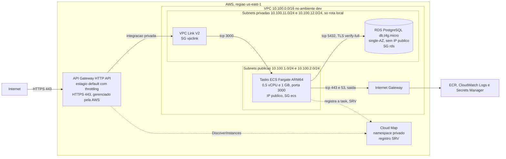
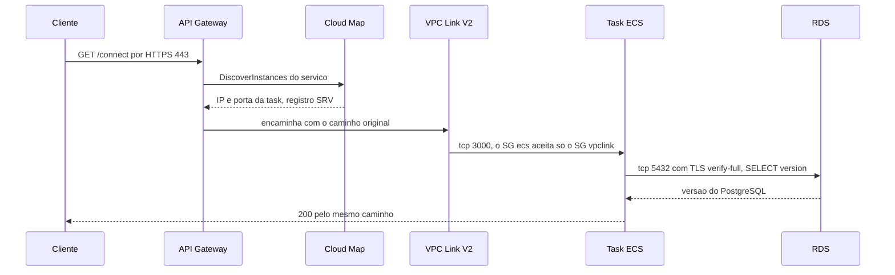
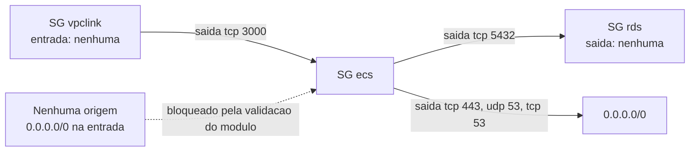

# Arquitetura

Este documento descreve o que o Terraform da pasta [`infrastructure/`](../infrastructure) cria na trilha ECS: rede, security groups, portas e o fluxo da internet até o banco. Tudo foi lido do código atual. Nada aqui foi aplicado na AWS (ver [Pendências no README](../README.md#pendências)).

Rótulos usados: `[FATO: fonte]` foi lido no repositório ou em documentação citada, `[HIPÓTESE]` é inferência não confirmada, `[PROPOSTA]` é uma recomendação.

## Visão geral

[FATO: [`infrastructure/main.tf`](../infrastructure/main.tf) linhas 67-101 (VPC, subnets, IGW), 147-183 (SGs), 186-203 (RDS), 206-214 (Cloud Map), 298-332 (ECS), 335-346 (API Gateway)]

O CIDR do diagrama é o do `dev` ([`dev.tfvars`](../infrastructure/environments/dev.tfvars) linhas 13-20). `hml` usa `10.110.0.0/16` e `prod` usa `10.120.0.0/16`.

## Fluxo da internet até o banco

Passo a passo, com o controle que atua em cada salto:

| # | Salto | Porta | Controle | Fonte |
|---|---|---|---|---|
| 1 | Internet para API Gateway | 443 | TLS terminado pelo serviço gerenciado; throttling no estágio `$default` | [`modules/apigw/main.tf`](../infrastructure/modules/apigw/main.tf) linhas 39-48 |
| 2 | API Gateway para Cloud Map | n/a | A integração usa o ARN do serviço Cloud Map como URI e descobre as tasks por `DiscoverInstances` | [`modules/apigw/main.tf`](../infrastructure/modules/apigw/main.tf) linhas 23-24 e [`00-fonte-da-verdade.md`](../.kiro/steering/00-fonte-da-verdade.md) (seção "Fatos de serviços AWS") |
| 3 | API Gateway para VPC Link V2 | n/a | `overwrite:path` = `$request.path` evita o nome do estágio no caminho do backend | [`modules/apigw/main.tf`](../infrastructure/modules/apigw/main.tf) linhas 26-30 |
| 4 | VPC Link para tasks | 3000/tcp | Saída do SG `vpclink` e entrada do SG `ecs`, ambas por referência de SG | [`rules-sg-vpclink.json`](../infrastructure/config/security_rules/rules-sg-vpclink.json), [`rules-sg-ecs.json`](../infrastructure/config/security_rules/rules-sg-ecs.json) |
| 5 | Tasks para RDS | 5432/tcp | Saída do SG `ecs` e entrada do SG `rds`; TLS com verificação do certificado (`DB_SSLMODE=verify-full`) | [`rules-sg-rds.json`](../infrastructure/config/security_rules/rules-sg-rds.json), [`main.tf`](../infrastructure/main.tf) linha 325 |
| 6 | Tasks para a internet | 443/tcp, 53/udp e 53/tcp | Saída do SG `ecs` para `0.0.0.0/0`: pull do ECR, logs e Secrets Manager | [`rules-sg-ecs.json`](../infrastructure/config/security_rules/rules-sg-ecs.json) linhas 12-36 |

A API não tem autenticação (contrato do desafio, ver [`docker-compose.yml`](../docker-compose.yml) linhas 4-5). Qualquer cliente na internet que conheça a URL do API Gateway alcança `/`, `/connect` e `/health`. A proteção disponível hoje é o throttling do estágio. [PROPOSTA: se a API deixar de ser apenas demonstração, avaliar um authorizer no API Gateway.]

## Security groups

Três security groups, criados pelo mesmo módulo ([`modules/security/security-group`](../infrastructure/modules/security/security-group/main.tf)) e ligados por referência de SG, nunca por IP. O motivo da modelagem está no [ADR 0010](adr/0010-regras-de-sg-por-chaves-simbolicas.md).

### Regras lidas do código

| SG | Direção | Protocolo e porta | Origem ou destino | Chave da regra | Arquivo |
|---|---|---|---|---|---|
| `vpclink` | entrada | nenhuma regra | n/a | n/a | [`rules-sg-vpclink.json`](../infrastructure/config/security_rules/rules-sg-vpclink.json) linha 2 |
| `vpclink` | saída | tcp 3000 | SG `ecs` | `to-ecs-3000` | idem, linhas 4-11 |
| `ecs` | entrada | tcp 3000 | SG `vpclink` | `from-vpclink-3000` | [`rules-sg-ecs.json`](../infrastructure/config/security_rules/rules-sg-ecs.json) linhas 3-10 |
| `ecs` | saída | tcp 443 | `0.0.0.0/0` | `https-443` | idem, linhas 13-20 |
| `ecs` | saída | udp 53 | `0.0.0.0/0` | `dns-udp-53` | idem, linhas 21-28 |
| `ecs` | saída | tcp 53 | `0.0.0.0/0` | `dns-tcp-53` | idem, linhas 29-36 |
| `ecs` | saída | tcp 5432 | SG `rds` | `to-rds-5432` | idem, linhas 37-44 |
| `rds` | entrada | tcp 5432 | SG `ecs` | `from-ecs-5432` | [`rules-sg-rds.json`](../infrastructure/config/security_rules/rules-sg-rds.json) linhas 3-10 |
| `rds` | saída | nenhuma regra | n/a | n/a | idem, linha 12 |

Pontos que seguem do código:

- Nenhum SG aceita `0.0.0.0/0` ou `::/0` na entrada. O módulo rejeita essa regra na validação da variável `ingress_rules` ([`modules/security/security-group/variables.tf`](../infrastructure/modules/security/security-group/variables.tf) linhas 61-66). [FATO: variables.tf:61-66]
- O provider remove a regra de saída "permitir tudo" que a AWS cria por padrão ao criar o SG em uma VPC, então só existe o egress declarado nos JSON. [FATO: documentação do `aws_security_group` na versão 6.68.0, citada na análise de design de 12/10/2026; não reverificada neste turno]
- As portas 8084 e `${ALB_SG_ID}` do repositório base (F-INF-1, F-INF-2, F-INF-4) não existem mais: a porta da task é 3000 e a origem é o SG do VPC Link. [FATO: rules-sg-ecs.json:3-10]
- As regras temporárias previstas na steering (gerador k6 para as tasks na 3000 e nós do EKS para o RDS na 5432, [`01-arquitetura-e-restricoes.md`](../.kiro/steering/01-arquitetura-e-restricoes.md) seção "Portas e fluxo de rede") não existem no código. Elas só entram durante os testes e o lab. [FATO: grep nos três JSON]
- A saída do `ecs` para `0.0.0.0/0` em 443 e 53 é necessária porque não há NAT nem VPC endpoints ([ADR 0005](adr/0005-sem-nat-tasks-em-subnet-publica.md)). Isso permite que um processo comprometido na task fale com qualquer destino HTTPS. O risco foi aceito pelo desenho e não há mitigação por prefix list hoje. [HIPÓTESE: o impacto real depende de a aplicação ser comprometida; não foi avaliado]

## Subnets e rotas

| Camada | Nomes em `dev.tfvars` | CIDR no `dev` | Tabela de rotas | O que roda lá |
|---|---|---|---|---|
| Pública | `public-subnet-1a`, `public-subnet-1b` | `10.100.1.0/24`, `10.100.2.0/24` | `0.0.0.0/0` para o Internet Gateway | Tasks ECS com IP público ([`main.tf`](../infrastructure/main.tf) linha 314) |
| Privada | `private-subnet-1a`, `private-subnet-1b` | `10.100.11.0/24`, `10.100.12.0/24` | Só a rota local da VPC | RDS (subnet group) e interfaces do VPC Link V2 ([`main.tf`](../infrastructure/main.tf) linhas 195 e 339) |

- As subnets públicas têm `map_public_ip_on_launch = true` e as privadas `false` ([`main.tf`](../infrastructure/main.tf) linhas 74-93). [FATO: main.tf:74-93]
- A rota pública vem de [`config/routes/public.json`](../infrastructure/config/routes/public.json) com o IGW resolvido por chave simbólica `igw` ([`main.tf`](../infrastructure/main.tf) linhas 112-119). As tabelas privadas não recebem rota nenhuma ([`main.tf`](../infrastructure/main.tf) linhas 129-134). [FATO: main.tf:112-134]
- Os sufixos `1a` e `1b` dos nomes são rótulos. As AZs reais são as duas primeiras de `data.aws_availability_zones` com `opt-in-status = opt-in-not-required` ([`main.tf`](../infrastructure/main.tf) linhas 16-35). O código não garante que sejam `us-east-1a` e `us-east-1b`. [FATO: main.tf:16-35]
- O RDS é uma instância single-AZ, mas o subnet group exige subnets em pelo menos 2 AZs, por isso existem duas subnets privadas ([`modules/rds/variables.tf`](../infrastructure/modules/rds/variables.tf) linhas 45-53). [FATO: rds/variables.tf:45-53]
- A VPC tem `enable_dns_support` e `enable_dns_hostnames` ligados, exigência da zona privada do Cloud Map ([`modules/network/vpc/main.tf`](../infrastructure/modules/network/vpc/main.tf) linhas 4-5). [FATO: vpc/main.tf:4-5]

## Cloud Map e registro das tasks

O namespace privado se chama `<ambiente>.<projeto>.local` (no `dev`: `dev.simple-api.local`) e o serviço se chama `api`, com registro SRV, política `MULTIVALUE` e TTL de 10 s ([`main.tf`](../infrastructure/main.tf) linhas 206-214, [`modules/cloudmap/main.tf`](../infrastructure/modules/cloudmap/main.tf) linhas 10-24, [`modules/cloudmap/variables.tf`](../infrastructure/modules/cloudmap/variables.tf) linhas 16-20). O TTL é `[PROPOSTA] a calibrar`. O ECS registra e remove cada task sozinho pelo bloco `service_registries` ([`modules/ecs/main.tf`](../infrastructure/modules/ecs/main.tf) linhas 97-105).

## Divergências entre a steering e o código

Regra do projeto: quando a steering e o código divergem, vale o que o código faz, e a divergência é apontada. Nada foi alterado no código para bater com a documentação.

| # | Steering diz | Código faz | Onde |
|---|---|---|---|
| 1 | [`01-arquitetura-e-restricoes.md`](../.kiro/steering/01-arquitetura-e-restricoes.md): módulos `alb`, `target-group` e `listener` ficam "para uma eventual flag `ingress_mode = "alb"`" | Não existe variável `ingress_mode` na raiz nem no módulo `ecs`. Só há um comentário e o bloco opcional `load_balancer` por `target_group_arn` | [`modules/ecs/main.tf`](../infrastructure/modules/ecs/main.tf) linhas 107-115 |
| 2 | [`08-testes-de-carga.md`](../.kiro/steering/08-testes-de-carga.md): cenário "3 tasks via API GW" com "throttling do estágio em 1.000" | `dev.tfvars` define `api_throttling_rate_limit = 50` e `api_throttling_burst_limit = 100`, ambos `[PROPOSTA] a calibrar` | [`dev.tfvars`](../infrastructure/environments/dev.tfvars) linhas 93-94 |
| 3 | [`00-fonte-da-verdade.md`](../.kiro/steering/00-fonte-da-verdade.md): tabelas F-APP e F-INF descrevem o repositório base | Os itens F-INF-1 a F-INF-4 e F-INF-7 a F-INF-11 já não valem no código atual: porta 3000, SG por chave simbólica, `azs` sem default hardcoded no módulo `route-table`, `map_public_ip_on_launch` usado, DNS ligado na VPC, circuit breaker e `service_registries` no ECS, módulos ECR, RDS, API Gateway, Cloud Map, autoscaling e OIDC criados. F-INF-5, F-INF-6 e F-INF-12 seguem presentes como arquivos ou módulos, mas não são instanciados na trilha ECS | seções acima, [`modules/network/route-table/variables.tf`](../infrastructure/modules/network/route-table/variables.tf) |
| 4 | [`infrastructure/README.md`](../infrastructure/README.md) linha 43: "O ADR dessa decisão ainda não foi escrito (pendente)" | O ADR agora existe: [ADR 0012](adr/0012-divergencia-da-arquitetura-alvo.md). A linha do README de infraestrutura não foi editada porque está fora do escopo desta entrega | [`infrastructure/README.md`](../infrastructure/README.md) |
