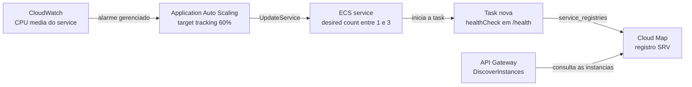

# Plano de autoscaling

Plano do ECS Service Auto Scaling da trilha ECS: métrica, alvo, limites, cooldowns, como o roteamento acompanha o número de tasks, tempo de reação esperado, limite de conexões com o banco e o que não foi validado. Os valores foram lidos do código. Nada foi aplicado na AWS.

Rótulos: `[FATO: fonte]`, `[HIPÓTESE]` e `[PROPOSTA]`.

## Parâmetros

| Parâmetro | Valor | Fonte |
|---|---|---|
| Alvo de escala | `aws_appautoscaling_target` com `service_namespace = "ecs"` e `scalable_dimension = "ecs:service:DesiredCount"` | [`modules/autoscaling/main.tf`](../infrastructure/modules/autoscaling/main.tf) linhas 1-8 |
| Tipo de política | `TargetTrackingScaling` | [`modules/autoscaling/main.tf`](../infrastructure/modules/autoscaling/main.tf) linhas 11-13 |
| Métrica | `ECSServiceAverageCPUUtilization` (CPU média das tasks do service) | [`modules/autoscaling/main.tf`](../infrastructure/modules/autoscaling/main.tf) linhas 23-25 |
| Valor alvo | 60% | [`modules/autoscaling/variables.tf`](../infrastructure/modules/autoscaling/variables.tf) linhas 23-27 |
| Mínimo de tasks | 1 | [`dev.tfvars`](../infrastructure/environments/dev.tfvars) linha 66 |
| Máximo de tasks | 3 | [`dev.tfvars`](../infrastructure/environments/dev.tfvars) linha 67 |
| Cooldown de scale-out | 60 s | [`modules/autoscaling/variables.tf`](../infrastructure/modules/autoscaling/variables.tf) linhas 29-33 |
| Cooldown de scale-in | 300 s | [`modules/autoscaling/variables.tf`](../infrastructure/modules/autoscaling/variables.tf) linhas 35-39 |
| Tamanho da task | 0,5 vCPU e 1 GB, ARM64 | [`dev.tfvars`](../infrastructure/environments/dev.tfvars) linhas 63-64 |
| Número inicial de tasks | 1 (`desired_count`), ignorado depois da criação | [`dev.tfvars`](../infrastructure/environments/dev.tfvars) linha 65 e [`modules/ecs/main.tf`](../infrastructure/modules/ecs/main.tf) linhas 119-126 |

A raiz passa ao módulo só `cluster_name`, `service_name`, `min_capacity` e `max_capacity` ([`main.tf`](../infrastructure/main.tf) linhas 349-356). O alvo de 60% e os cooldowns são os padrões do módulo. [FATO: arquivos citados]

O alvo de 60% sobre uma task de 0,5 vCPU equivale a cerca de 0,3 vCPU de uso médio por task (cálculo: 0,6 × 0,5). Medido na AWS em 13/10/2026 (dentro da VPC, 1 task, autoscaling suspenso, `/connect`): CPU média por minuto de 32% a 500 req/s, 63% a 1.000 req/s e 81% perto de 1.500 req/s, sem erro. Por interpolação de uma série por perfil, o alvo de 60% corresponde a cerca de 1.000 req/s por task [HIPÓTESE: 1 série por perfil, CPU com granularidade de 1 min]. [FATO: `tests/load/results/2026-10-13-aws-vpc.csv` e [`docs/performance/benchmark-aws.md`](performance/benchmark-aws.md)]

## Como o roteamento acompanha

- O ECS registra cada task no serviço Cloud Map pelo bloco `service_registries` (`registry_arn`, `container_name`, `container_port`) e remove a task quando ela para. Não há ação manual nem Lambda de registro. [FATO: [`modules/ecs/main.tf`](../infrastructure/modules/ecs/main.tf) linhas 97-105]
- O registro é SRV, política `MULTIVALUE`, TTL de 10 s (`[PROPOSTA] a calibrar`). [FATO: [`modules/cloudmap/main.tf`](../infrastructure/modules/cloudmap/main.tf) linhas 16-23 e [`variables.tf`](../infrastructure/modules/cloudmap/variables.tf) linhas 16-20]
- O API Gateway descobre as tasks por `DiscoverInstances` no ARN do serviço Cloud Map. [FATO: [`modules/apigw/main.tf`](../infrastructure/modules/apigw/main.tf) linhas 23-24]
- Não há load balancer. O sinal de saúde é o `healthCheck` do container: `wget -qO- http://localhost:3000/health || exit 1`, com intervalo de 30 s, timeout de 5 s, 3 tentativas e 15 s de carência inicial. [FATO: [`modules/ecs/main.tf`](../infrastructure/modules/ecs/main.tf) linhas 57-63 e [`modules/ecs/variables.tf`](../infrastructure/modules/ecs/variables.tf) linhas 138-160]
- `/health` responde 200 enquanto o processo está de pé e não consulta o banco. Um banco fora do ar não marca a task como não saudável. [FATO: [`application/src/app.js`](../application/src/app.js) linhas 59-62]
- [HIPÓTESE: o ECS só registra a task no Cloud Map depois de ela ficar saudável pelo `healthCheck`, e remove a instância se ela ficar não saudável. Este comportamento não foi verificado nem na documentação nem na AWS. Confirmar com `aws servicediscovery discover-instances` e `get-instances-health-status` durante o primeiro teste]
- Durante um deploy o service pode ter até 200% das tasks (`deployment_maximum_percent = 200`) e mantém 100% saudáveis (`deployment_minimum_healthy_percent = 100`). O circuit breaker com rollback está ligado. [FATO: [`modules/ecs/variables.tf`](../infrastructure/modules/ecs/variables.tf) linhas 162-172 e [`modules/ecs/main.tf`](../infrastructure/modules/ecs/main.tf) linhas 83-89]

## Tempo de reação esperado: 3 a 5 minutos

A estimativa de 3 a 5 minutos vem da steering ([`01-arquitetura-e-restricoes.md`](../.kiro/steering/01-arquitetura-e-restricoes.md) seção "Autoscaling"). **Medido na AWS em 13/10/2026** (spike de 100 para 1.500 req/s pelo API Gateway, uma execução; detalhes em [`performance/benchmark-aws.md`](performance/benchmark-aws.md), dados em `tests/load/results/2026-10-13-aws-spike*.`):

- Do salto de carga (~22:50:05 UTC, estimado) até a decisão de scale-out 1 → 2: **~5 min** (22:55:05). A única task ficou com CPU de 95–98% de 22:51 a 22:54.
- Da decisão até a task nova rodando: **~44 s** (22:55:49); a instância entrou no Cloud Map em ~31 s (22:55:38).
- Segundo degrau 2 → 3 decidido 3 min depois (22:58:05), com 3 tasks rodando em 22:58:47. A CPU média caiu para 42% e depois 22%.
- Scale-in: 3 → 2 às 23:16:07 (**~16 min depois do fim do spike**, 15 períodos de 1 min abaixo de 54%) e 2 → 1 às 23:22:07 (cooldown de 300 s). Total de ~22 min para voltar a 1 task.
- Durante os ~5 min de saturação: p95 chegou a 290 ms num minuto e o erro a 0,03–0,17% por minuto; o scale-in 3 → 2 gerou 8 respostas 5xx. O p50 ficou em ~5 ms o tempo todo.

Os alarmes criados pelo target tracking (`describe-alarms`): scale-out = 3 períodos de 1 min com CPU > 60%; scale-in = 15 períodos de 1 min com CPU < 54%. A tabela abaixo é a decomposição estimada antes da medição:

| Etapa | O que acontece | Duração | Base |
|---|---|---|---|
| 1. Detecção | O Application Auto Scaling cria e gerencia os alarmes do CloudWatch do target tracking. O alarme de scale-out precisa de alguns minutos de métrica acima do alvo antes de disparar | Alguns minutos. O número exato de períodos **a verificar** | Steering e a doc do Application Auto Scaling, que diz que o serviço cria e gerencia esses alarmes e que eles não devem ser editados |
| 2. Subida da task | O Fargate baixa a imagem do ECR, inicia o container e o `healthCheck` passa a responder | Cerca de 1 minuto, segundo a steering. **Não medido** | Steering. O `startPeriod` de 15 s é carência, não duração do start |
| 3. Roteamento | O registro SRV tem TTL de 10 s e o API Gateway consulta o Cloud Map | Segundos. O custo do Cloud Map (72.921 chamadas para 1.078.187 requisições, ~1 por 15) indica que o API Gateway **não** chama `DiscoverInstances` a cada requisição, o que é consistente com cache ou agrupamento; o mecanismo **não foi verificado** | Lista "DESCONHECIDO" de [`00-fonte-da-verdade.md`](../.kiro/steering/00-fonte-da-verdade.md) |

Fonte do comportamento dos alarmes e do cooldown padrão de 300 s para serviços ECS: https://docs.aws.amazon.com/autoscaling/application/userguide/target-tracking-scaling-policy-overview.html, aberta em 13/10/2026.

O cooldown de scale-out de 60 s não atrasa a primeira reação. Ele limita a frequência de novos scale-outs depois de um. O cooldown de scale-in de 300 s evita que o service volte a 1 task logo depois de um pico. [HIPÓTESE: leitura do significado dos cooldowns na doc; o efeito exato sobre o target tracking não foi medido]

Efeito prático: um pico que dure menos de uns 3 minutos pode passar inteiro sobre a task que já existe. Por isso o spike do plano de carga mede o SLO separadamente durante os primeiros minutos e depois deles. [FATO: [`08-testes-de-carga.md`](../.kiro/steering/08-testes-de-carga.md) seção "Perfis"]

## Limite de conexões com o banco

- Cada task abre no máximo `DB_POOL_MAX` conexões. Na AWS o valor é 3 (padrão da variável da raiz, repetido no `dev.tfvars`). O padrão do código da aplicação, sem a variável, é 5. [FATO: [`dev.tfvars`](../infrastructure/environments/dev.tfvars) linha 70, [`main.tf`](../infrastructure/main.tf) linha 326 e [`application/src/config.js`](../application/src/config.js) linha 62]
- Pior caso durante um deploy, com `deployment_maximum_percent = 200`: 3 tasks × 2 × 3 conexões = 18. Com o lab EKS ligado, a steering soma (3 + 1) × 3 = 12, total 30. [FATO: cálculo da steering em [`01-arquitetura-e-restricoes.md`](../.kiro/steering/01-arquitetura-e-restricoes.md) seção "Conexões com o banco"; o termo de 18 foi reconferido neste turno com os valores do código]
- A regra da steering é manter a soma no pior momento em até 50% de `max_connections`. O `max_connections` real do `db.t4g.micro` é **desconhecido**: a steering estima 80 a 110 e manda confirmar com `SHOW max_connections;`. Com 80 a 110, 50% dá 40 a 55 conexões, e 30 cabe. Com `max_connections` abaixo de 60, não cabe. [HIPÓTESE: depende do valor real, a verificar no RDS]
- Cada conexão tem `connectionTimeoutMillis` de 2000 ms, `idleTimeoutMillis` de 10000 ms e `statement_timeout` e `query_timeout` de 3000 ms. [FATO: [`application/src/db.js`](../application/src/db.js) linhas 6-9]
- O benchmark LOCAL usou pool de 5; a AWS usa 3. A folga por task segue grande no benchmark (cada consulta leva cerca de 1 ms), mas com 3 conexões o comportamento sob carga precisava ser revalidado. Na AWS, com 1 task e `DB_POOL_MAX=3`, as taxas de até 1.500 req/s (rampa) não geraram erro. O `max_connections` do RDS foi medido em 79 (13/10/2026), e 18 conexões no pior caso (3 tasks × 2 no deploy × 3) ficam abaixo de 50% disso. [FATO: [`08-testes-de-carga.md`](../.kiro/steering/08-testes-de-carga.md) regra de execução 6; [`01-arquitetura-e-restricoes.md`](../.kiro/steering/01-arquitetura-e-restricoes.md) seção "Conexões com o banco"]

## Custo do autoscaling

- Cada task extra custa o Fargate ARM64 (0,5 vCPU e 1 GB: US$ 0,01975/h, cálculo sobre a tabela de preços da steering, ver [ADR 0003](adr/0003-ecs-fargate-arm64-0-5-vcpu-1-gb.md)) mais um IPv4 público a US$ 0,005/h ([ADR 0005](adr/0005-sem-nat-tasks-em-subnet-publica.md)). Somando, US$ 0,02475/h por task adicional (cálculo: 0,01975 + 0,005). [FATO: [`02-finops-guardrails.md`](../.kiro/steering/02-finops-guardrails.md) seção "Preços de referência"]
- Duas tasks adicionais por 1 hora custam, portanto, cerca de US$ 0,0495 (cálculo: 2 × 0,02475). O custo de cada consulta ao Cloud Map (US$ 1,00 por milhão de chamadas) foi medido: 72.921 chamadas = US$ 0,073 para 1.078.187 requisições (ver [`plano/05-custo-real.md`](plano/05-custo-real.md)).

## Interação com o throttling do API Gateway

O estágio `$default` limita as requisições em 50 req/s com burst de 100 no `dev`, valores `[PROPOSTA] a calibrar`. [FATO: [`dev.tfvars`](../infrastructure/environments/dev.tfvars) linhas 93-94] O benchmark LOCAL mediu uma task de 0,5 vCPU atendendo 1.000 req/s dentro do SLO. Se o desempenho na AWS ficar na mesma ordem de grandeza, 50 req/s pelo API Gateway não gera 60% de CPU média e o autoscaling não dispararia. [HIPÓTESE: extrapolação do número LOCAL, que não vale para a AWS] Para exercitar o autoscaling, o spike precisa subir o limite do estágio acima da carga do teste, como manda a steering. [FATO: [`02-finops-guardrails.md`](../.kiro/steering/02-finops-guardrails.md) seção "Testes de carga e custo"]

A steering ([`08-testes-de-carga.md`](../.kiro/steering/08-testes-de-carga.md)) estima 1.500 req/s para 3 tasks "com throttling do estágio em 1.000". O código define 50 e 100. É uma divergência: vale o código, e a estimativa assume um limite que ainda não foi configurado.

## Mudança de capacidade e `ignore_changes`

O service ignora `desired_count` e `task_definition` ([`modules/ecs/main.tf`](../infrastructure/modules/ecs/main.tf) linhas 124-126). Por isso:

- O autoscaling é dono da contagem de tasks. Um `terraform apply` não desfaz uma escala em andamento.
- Mudar `autoscaling_min_capacity` ou `autoscaling_max_capacity` no `tfvars` altera o alvo de escala do Application Auto Scaling, e esse recurso não está em `ignore_changes`. [FATO: [`modules/autoscaling/main.tf`](../infrastructure/modules/autoscaling/main.tf) linhas 1-8]
- Mudar CPU ou memória da task pelo Terraform não chega ao service sem um deploy pelo pipeline. Ver o trade-off no [`infrastructure/README.md`](../infrastructure/README.md) linhas 45-50.

## O que não foi validado na AWS

Foram medidos na AWS (13/10/2026) a CPU por task em função da taxa, o `max_connections` e a **reação do autoscaling** (spike, uma execução). Está pendente:

- (Resolvido) O target tracking criou os alarmes e escalou de 1 para 3 tasks e de volta; tempos na seção "Tempo de reação". Falta repetir a medição para ter variação entre execuções.
- (Resolvido) Períodos dos alarmes: 3 de 1 min (scale-out) e 15 de 1 min (scale-in).
- Se o Fargate aplica a cota de CPU com throttling igual ao cgroup local (item "DESCONHECIDO" da steering). A relação entre CPU e requisições por segundo já foi medida (acima), com 1 série por perfil.
- Que a task nova entra no Cloud Map só depois de saudável, e que a saída de uma task remove o registro antes de o tráfego falhar.
- (Medido) Custo do Cloud Map: ~1 chamada por 15 requisições do API Gateway; o mecanismo de cache não foi verificado.
- (Resolvido) `max_connections` do RDS `db.t4g.micro` = 79; 18 conexões no pior caso do ECS cabem. O cenário com EKS não foi testado.
- O comportamento durante um deploy com `deployment_maximum_percent = 200` junto de um evento de escala.
- Quantos IPv4 públicos ficam cobrados com 3 tasks.

[PROPOSTA] Plano de verificação, todo dependente de aprovação e de estimativa de custo antes de qualquer execução (regra 7 do [`AGENTS.md`](../AGENTS.md)):

1. Subir o limite de throttling do estágio acima da carga do teste.
2. Rodar o spike descrito em [`08-testes-de-carga.md`](../.kiro/steering/08-testes-de-carga.md), registrando CPU média, contagem de tasks e SLO antes, durante e depois da escala.
3. Ler `aws application-autoscaling describe-scaling-activities` para obter os horários reais de cada etapa.
4. (Feito em 14/10) Linha do Cloud Map no Cost Explorer: ver [`plano/05-custo-real.md`](plano/05-custo-real.md).
5. Rodar `SHOW max_connections;` no RDS e comparar com a conta de conexões.
